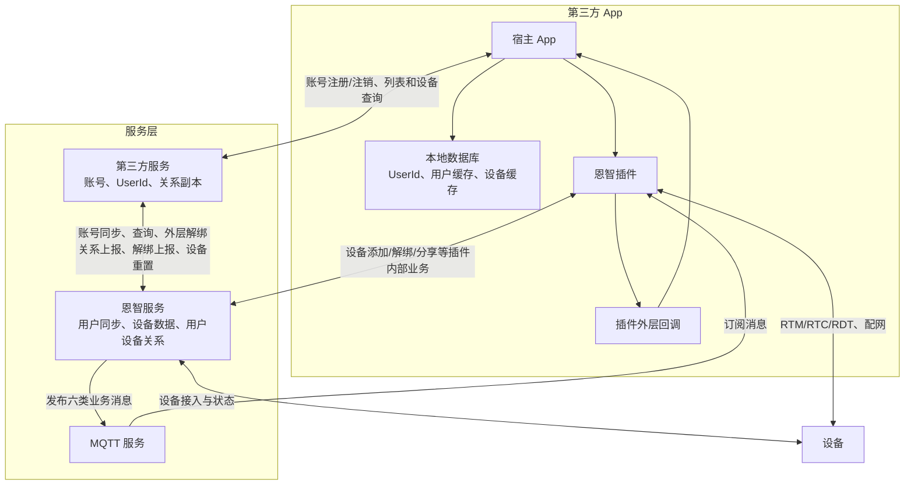
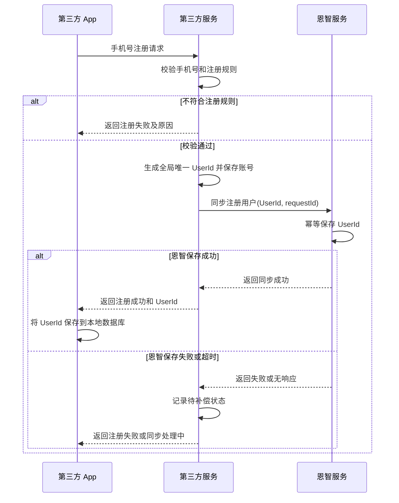
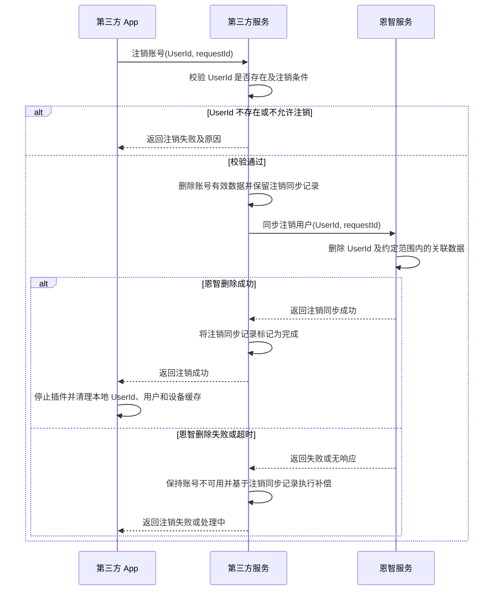
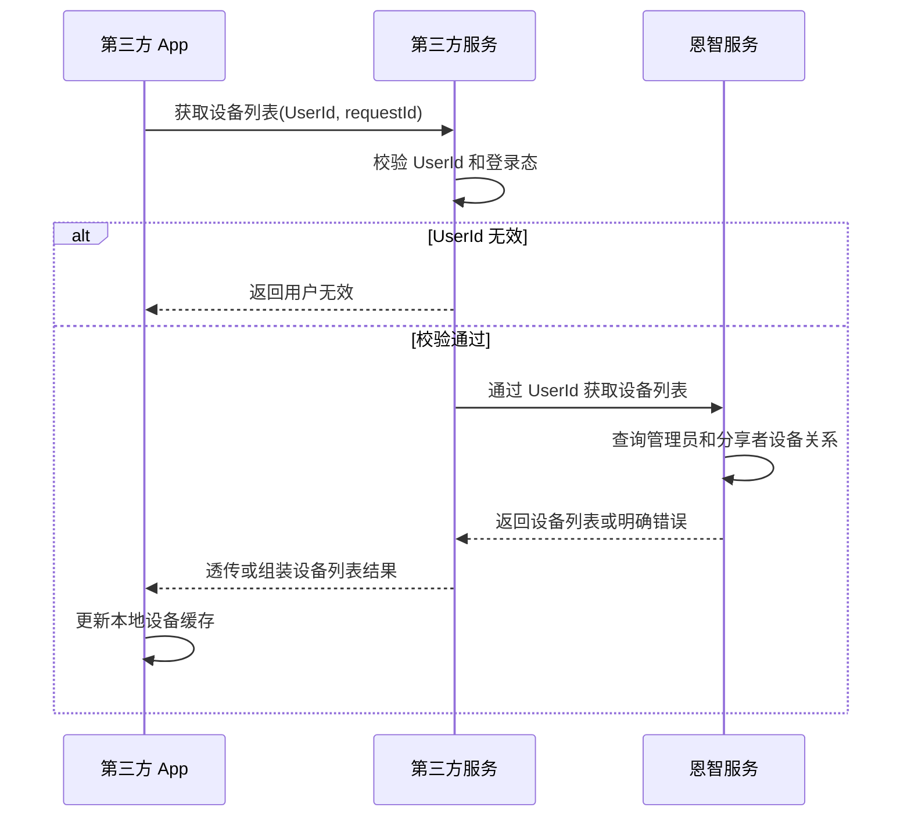
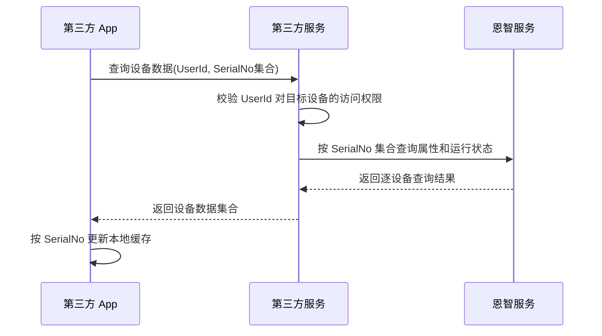
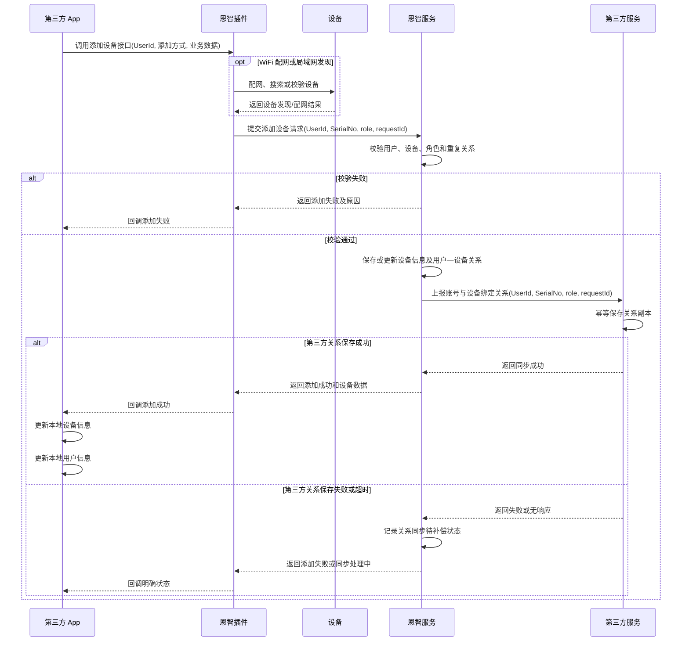
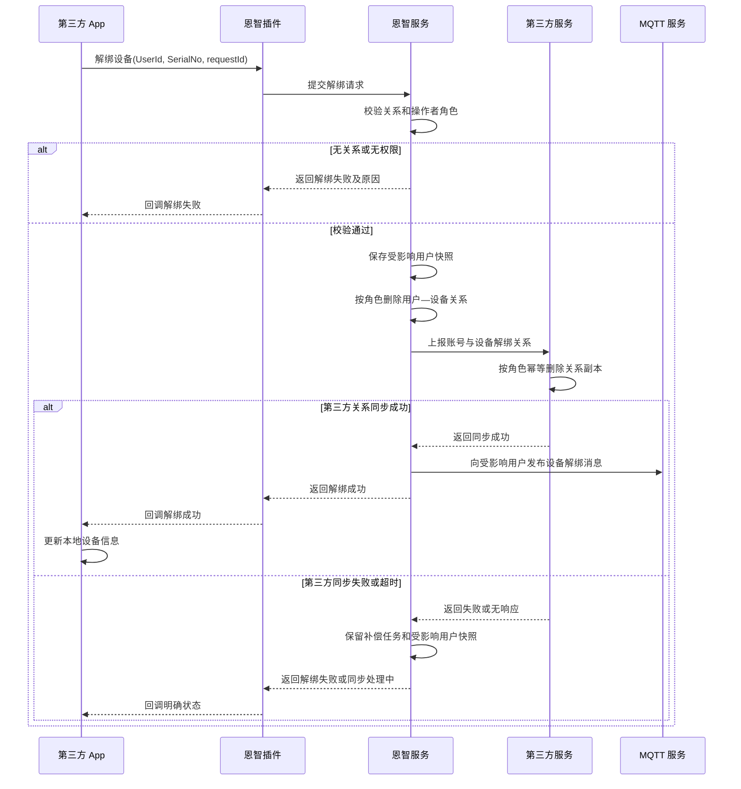
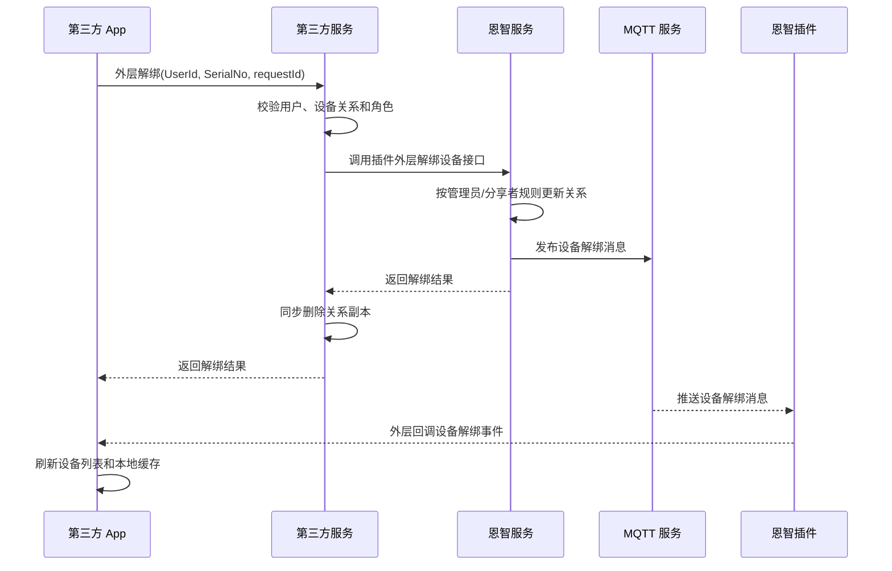
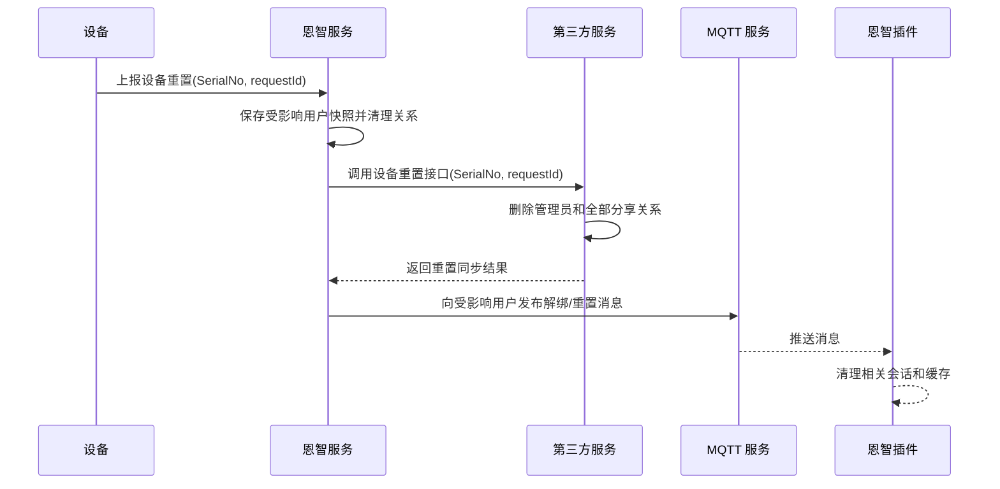
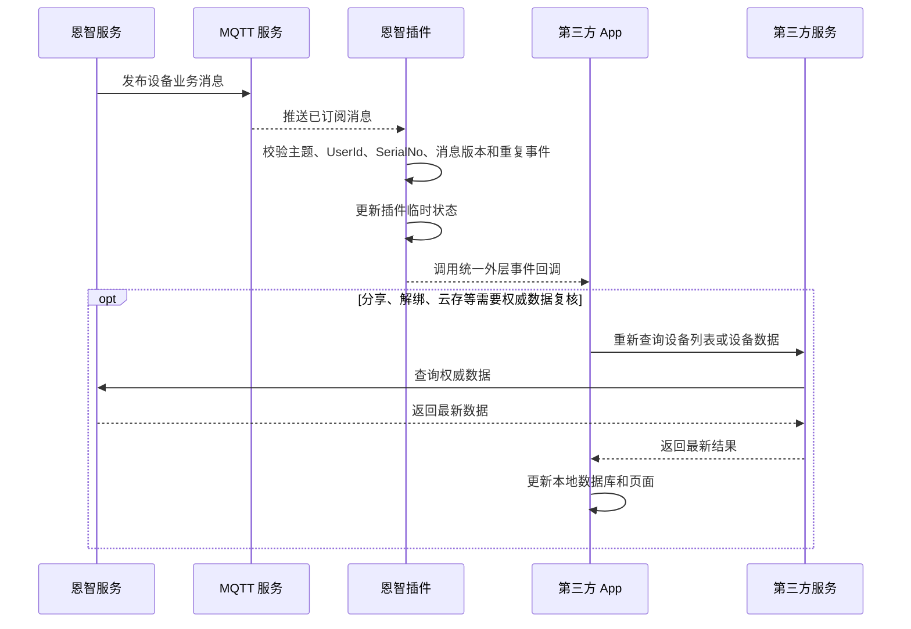

# App 端插件化开发方案设计

## 1. 文档概述

### 1.1 背景

恩智 App 已具备设备添加、分享、实时预览、录像回放、参数配置等能力。为降低第三方 App 的接入成本，现将相关能力封装为插件，并统一第三方 App、插件、第三方服务、恩智服务和设备之间的业务边界、数据流向及接口责任。

本次方案重点明确两类业务：

- **插件内部业务**：由第三方 App 调用恩智插件，插件直接与恩智服务交互，不经过第三方服务。
- **插件外部业务**：由第三方 App 调用第三方服务，第三方服务再调用恩智服务。

### 1.2 文档目的

本文用于明确以下内容：

- App 账号注册、注销以及 `UserId` 的生成、同步和本地保存方式。
- 设备添加、解绑、分享、设备列表和设备信息查询的调用链路。
- 第三方服务与恩智服务各自维护的数据及双方需要提供的接口。
- 插件订阅的 MQTT 消息类型以及向插件外层回调的要求。
- 管理员和分享者解绑、设备重置等场景的数据清理范围。
- 跨系统写入、MQTT 通知、本地缓存更新的完成标准和一致性要求。

### 1.3 方案范围

| 范围 | 内容 |
| --- | --- |
| 账号业务 | 手机号注册、`UserId` 生成与同步、账号注销 |
| 插件内部业务 | 绑定添加、分享添加、局域网添加、WiFi 配网添加、设备解绑、预览、回放、参数配置 |
| 插件外部业务 | 账号注册、账号注销、获取设备列表、获取设备基本属性与运行状态 |
| 数据同步 | 用户数据同步、用户—设备关系绑定/解绑同步、设备重置同步 |
| 消息通知 | 设备属性、设备状态、设备已唤醒、云存储开通或核销、设备分享、设备解绑 |
| 通信能力 | HTTP/HTTPS、MQTT、RTM、RTC、RDT、蓝牙、声波和局域网发现 |

接口 URL、最终字段名、错误码、MQTT 主题、重试参数和 SDK 版本尚未确定的内容，统一列入“后续待确认事项”，不在本文中描述为已定协议。

### 1.4 核心设计原则

- **业务分层明确**：插件内部业务直连恩智服务；插件外部业务经第三方服务转发。
- **统一用户标识**：第三方服务生成全局唯一 `UserId`，第三方 App、第三方服务和恩智服务均以 `UserId` 关联同一用户。
- **数据各有归属**：第三方服务负责账号及用户—设备关系副本；恩智服务负责插件业务、设备数据及用户—设备关系；第三方 App 只保存当前用户标识和本地展示缓存。
- **关系双向同步**：恩智服务产生的绑定、解绑和设备重置结果必须同步到第三方服务，双方都能按 `UserId` 或设备序列号查询关系。
- **角色语义一致**：所有设备关系必须明确管理员或分享者角色；管理员解绑和分享者解绑的影响范围不得混淆。
- **消息必须外传**：插件收到约定的 MQTT 消息后，必须通过插件外层回调通知第三方 App。
- **服务端结果为准**：App 本地数据库只用于缓存和展示，不作为账号、设备关系或设备状态的最终依据。
- **完成状态分离**：接口受理、数据库写入、跨服务同步、MQTT 发布、插件回调和 App 本地更新是不同阶段，日志和错误处理不得将其混为一个状态。
- **幂等和可补偿**：写接口使用唯一请求标识，重复请求不得产生重复数据；跨服务同步失败必须可重试、可查询、可对账。

### 1.5 表述约定

- “必须”“不得”表示接入和实现必须遵守的约束。
- “应”表示推荐遵守的实现要求；不采用时需要提供等效方案。
- “建议”表示尚可在接口评审或联调阶段调整的设计。
- “待确认”表示尚未形成最终协议，开发或联调前必须由相关责任方确认。
- 本文中的“删除设备”默认指删除用户—设备关系，不等同于删除设备主数据；需要删除设备主数据时必须在接口中另行明确。

## 2. 术语与角色

| 术语 | 说明 |
| --- | --- |
| 第三方 App | 集成恩智插件能力的宿主应用，负责账号页面、本地数据库、页面承载和插件外层回调处理 |
| 恩智插件 | 集成在第三方 App 中的业务模块，负责设备添加、解绑、分享、预览、回放、参数配置和 MQTT 消息接收 |
| 插件内部业务 | 插件直接调用恩智服务完成的业务，不经过第三方服务 |
| 插件外部业务 | 第三方 App 调用第三方服务，再由第三方服务调用恩智服务完成的业务 |
| 第三方服务 | 负责手机号账号规则、生成 `UserId`、维护账号数据和用户—设备关系副本，并向第三方 App 提供外部业务接口 |
| 恩智服务 | 负责同步用户、插件业务、设备数据、用户—设备关系、MQTT 消息以及设备通信能力 |
| UserId | 第三方服务生成的用户唯一标识，作为第三方 App、第三方服务和恩智服务之间的统一用户主键 |
| SN / SerialNo | 设备序列号，作为设备唯一标识；本文统一写作 `SerialNo` |
| 管理员 | 设备的绑定用户，拥有设备管理和分享权限 |
| 分享者 | 通过分享关系获得设备访问权限的用户，其权限受分享范围和有效期限制 |
| 用户—设备关系 | `UserId + SerialNo + role` 及可选权限、通道、有效期等数据 |
| 本地数据库 | 第三方 App 内部数据库，只保存当前账号和设备展示缓存，不作为服务端权威数据 |
| MQTT 外层回调 | 恩智插件将 MQTT 消息转换为稳定的插件事件后，回调给第三方 App 的公开接口 |
| requestId | 单次业务请求唯一标识，用于幂等、日志关联、重试和对账 |

## 3. 业务划分与职责边界

### 3.1 业务划分

| 业务 | 类型 | App 调用路径 | 说明 |
| --- | --- | --- | --- |
| App 账号注册 | 插件外部业务 | 第三方 App → 第三方服务 → 恩智服务 | 第三方服务生成 `UserId`，再同步给恩智服务 |
| App 账号注销 | 插件外部业务 | 第三方 App → 第三方服务 → 恩智服务 | 双方删除对应用户数据 |
| 获取设备列表 | 插件外部业务 | 第三方 App → 第三方服务 → 恩智服务 | 第三方服务校验用户后向恩智服务查询 |
| 获取设备基本属性与运行状态 | 插件外部业务 | 第三方 App → 第三方服务 → 恩智服务 | 支持单个或多个设备查询 |
| 绑定添加设备 | 插件内部业务 | 第三方 App → 恩智插件 → 恩智服务 | 恩智落库后向第三方服务上报绑定关系 |
| 分享添加设备 | 插件内部业务 | 第三方 App → 恩智插件 → 恩智服务 | 关系中必须包含分享者角色及分享权限 |
| 局域网添加设备 | 插件内部业务 | 第三方 App → 恩智插件 → 恩智服务 | 发现方式属于插件内部实现 |
| WiFi 配网添加设备 | 插件内部业务 | 第三方 App → 恩智插件 → 恩智服务/设备 | 蓝牙或声波配网及后续添加均由插件编排 |
| App 主动解绑 | 插件内部业务 | 第三方 App → 恩智插件 → 恩智服务 | 恩智删除关系并向第三方服务上报解绑 |
| 第三方业务触发解绑 | 插件外部业务 | 第三方 App → 第三方服务 → 恩智服务 | 调用恩智提供的插件外层解绑接口 |
| 实时预览、回放、参数配置 | 插件内部业务 | 第三方 App → 恩智插件 → 设备/恩智服务 | 不经过第三方服务的业务编排 |

### 3.2 数据归属

| 数据 | 生成方 | 主要存储方 | 使用要求 |
| --- | --- | --- | --- |
| 手机号及账号规则数据 | 第三方服务 | 第三方服务 | 恩智服务不承担手机号注册规则校验 |
| `UserId` | 第三方服务 | 第三方服务、恩智服务、第三方 App 本地 | 三方必须使用同一个值，不得重新生成或替换 |
| 设备主数据、基本属性和运行状态 | 恩智服务/设备 | 恩智服务 | 第三方服务和 App 按需查询或缓存 |
| 用户—设备关系 | 恩智插件业务产生 | 恩智服务、第三方服务 | 恩智先处理插件业务，再向第三方服务同步关系 |
| 设备列表 | 恩智服务根据 `UserId` 查询 | 第三方 App 本地可缓存 | App 每次主动刷新以服务端返回为准 |
| MQTT 事件 | 恩智服务/设备 | MQTT 服务，App 可短期处理 | 消息用于实时通知，不替代服务端数据查询 |

### 3.3 各方职责

| 参与方 | 主要职责 |
| --- | --- |
| 第三方 App | 发起账号外部业务；保存 `UserId`；初始化和调用插件；接收插件业务结果及 MQTT 外层回调；更新本地用户和设备缓存 |
| 恩智插件 | 对外提供稳定接口；完成设备添加、解绑、分享、预览、回放和参数配置；管理 MQTT 连接与订阅；向第三方 App 回调结果和事件 |
| 第三方服务 | 校验手机号账号规则；生成唯一 `UserId`；维护账号和用户—设备关系副本；向恩智提供关系上报、解绑上报和设备重置接口 |
| 恩智服务 | 同步 `UserId`；维护设备数据及用户—设备关系；处理插件内部业务；向第三方服务同步关系；提供查询、外层解绑和 MQTT 发布能力 |
| MQTT 服务 | 向已订阅的恩智插件推送设备属性、状态、已唤醒、云存储、分享和解绑消息 |
| 设备 | 执行配网、预览、回放、参数设置、状态上报以及设备侧重置等操作 |

### 3.4 总体架构

### 3.5 调用约束

- 插件内部业务不得为了访问恩智服务而绕行第三方服务。
- 插件外部业务不得由第三方 App 绕过第三方服务直接调用恩智服务。
- 第三方 App 不直接持有插件内部的 HTTP、MQTT、RTM、RTC 或 RDT 客户端。
- `UserId` 必须由第三方服务生成；恩智服务和插件只接收、校验和使用，不重新分配。
- 用户—设备关系发生变化时，恩智服务与第三方服务最终必须一致；App 本地更新不能代替服务端同步。
- 所有新增接口均需明确调用方、鉴权方式、幂等键、完成状态和错误码，不能只定义 URL。

## 4. App 账号流程

### 4.1 App 账号注册

账号注册属于插件外部业务，不调用恩智插件。

处理要求：

- `UserId` 必须全局唯一且注册成功后保持稳定。
- App 后续账号、查询和插件调用均使用同一 `UserId`。
- 第三方服务不得在恩智同步失败后静默返回完整成功。若产品允许异步补偿，必须返回明确的“同步处理中”状态，并禁止依赖恩智用户数据的后续业务提前执行。
- 恩智注册同步接口按 `UserId` 和 `requestId` 幂等处理。
- 日志不得记录完整手机号、验证码或登录凭证。

### 4.2 App 账号注销

账号注销属于插件外部业务。第三方 App 使用 `UserId` 发起注销，不以本地是否存在设备缓存作为注销依据。

处理要求：

- 第三方服务校验通过后先将 `UserId` 从有效账号数据中删除或标记为已注销，再向恩智服务同步注销，符合“双方均删除该用户”的业务顺序。
- 为避免账号删除后丢失补偿依据，第三方服务应保留不可用于登录的注销同步记录，至少包含 `UserId`、`requestId`、处理阶段和最后错误；恩智同步完成后再按审计策略清理该记录。
- 恩智服务删除 `UserId` 时是否同时删除全部用户—设备关系、分享关系和历史数据，必须在注销协议中明确。
- 注销完成后，第三方 App 必须停止插件、取消 MQTT 订阅并清理本地用户上下文。
- 重复注销请求应返回同一最终结果，不得产生不可恢复的中间状态。

### 4.3 登录与认证边界

本方案只规定注册成功后第三方 App 将 `UserId` 保存到本地，并在后续业务中使用 `UserId` 标识用户。登录凭证的签发、刷新、失效和安全存储由第三方服务协议另行定义。

`UserId` 是用户标识，不应单独作为安全认证凭证。正式接口应同时携带第三方服务签发的登录凭证或签名信息，避免仅凭已知 `UserId` 访问用户数据。

## 5. 设备列表与设备数据查询

### 5.1 获取设备列表

获取设备列表属于插件外部业务。

设备列表至少应能表达：

- `UserId`。
- `SerialNo`。
- 当前用户角色：管理员或分享者。
- 分享者的通道、权限和有效期（如适用）。
- 设备基本信息和运行状态，或用于继续批量查询这些数据的标识。

处理要求：

- 第三方服务必须先校验 `UserId` 和登录态，再向恩智服务查询。
- App 本地设备列表仅用于展示；登录、切换账号、收到分享/解绑消息或用户主动刷新时，应重新查询服务端。
- 单个设备查询失败不得导致整个列表被错误清空；批量接口应返回逐设备结果或失败明细。

### 5.2 获取设备基本属性与运行状态

该业务属于插件外部业务。第三方 App 向第三方服务请求，第三方服务调用恩智服务的设备序列号集合查询接口。

接口必须同时支持：

- 单个设备查询：`SerialNo` 集合中只有一个元素。
- 多个设备批量查询：一次提交多个 `SerialNo`。

建议单个设备结果包含以下数据，最终字段以接口协议为准：

| 数据类别 | 建议内容 |
| --- | --- |
| 标识 | `SerialNo`、设备名称、型号、类型 |
| 能力 | 通道数、固件版本、P2P/媒体能力、云存储能力 |
| 运行状态 | 在线、离线、已唤醒、休眠或未知，以及状态更新时间 |
| 网络信息 | 网络类型、信号信息、IP/MAC 等非敏感运行数据 |
| 存储信息 | 磁盘或存储卡状态、容量和异常状态 |
| 查询结果 | 单设备成功/失败状态、错误码和错误描述 |

## 6. App 设备添加

### 6.1 适用场景

以下添加方式均属于插件内部业务：

- 绑定添加。
- 分享添加。
- 局域网添加。
- WiFi 配网添加。

添加方式只影响插件内部的发现、校验或配网步骤，不改变最终的关系同步要求：恩智服务保存用户—设备关系，并将 `UserId + SerialNo + role` 等关系数据上报给第三方服务。

### 6.2 统一添加流程

### 6.3 不同添加方式的处理边界

| 添加方式 | 插件内部处理 | 最终关系 |
| --- | --- | --- |
| 绑定添加 | 扫码或输入设备信息，校验设备可绑定和当前用户权限 | `role=admin` |
| 分享添加 | 校验分享邀请、有效期、通道和权限 | `role=shared`，同时保存分享范围 |
| 局域网添加 | 在局域网发现设备并完成身份校验 | 通常为 `role=admin`，具体以业务规则为准 |
| WiFi 配网添加 | 通过蓝牙或声波下发 WiFi 参数，待设备上线后完成添加 | 通常为 `role=admin` |

### 6.4 添加结果和本地更新

- 插件必须向外层回调添加成功、添加失败或明确的同步处理中状态。
- 添加成功后，第三方 App 根据返回数据新增或更新本地设备信息，并同步更新本地用户信息。
- 添加失败时，第三方 App 应清理本次添加产生的临时设备数据并恢复本地用户状态，不得保留可被误认为已绑定的正式设备关系。
- 如果接口只允许成功/失败两种结果，则只有恩智关系落库和第三方关系同步都成功后才能返回成功。
- 如果采用最终一致性，必须增加可查询的处理中状态；不能在第三方服务尚未同步时直接返回不可区分的成功。
- WiFi 密码、完整 Token、设备密钥等敏感数据不得写入日志或长期保存在 App 本地数据库。

## 7. App 设备解绑与设备重置

### 7.1 解绑角色规则

| 操作者角色 | 删除范围 | 不得影响的数据 |
| --- | --- | --- |
| 管理员 | 删除管理员关系及该设备的全部分享关系 | 不删除设备主数据，除非接口另有明确约定 |
| 分享者 | 只删除当前 `UserId` 的分享关系 | 管理员关系和其他分享者关系 |

### 7.2 插件内部解绑流程

本文所称“恩智服务将设备序列号从数据库中删除”，具体实现应解释为删除目标用户与 `SerialNo` 的关系记录。管理员解绑是否同时删除全部分享关系，按 7.1 节执行；不得直接删除仍可能被其他业务引用的设备主数据。

第三方 App 应根据插件回调更新本地设备信息：解绑成功时删除对应关系缓存并刷新列表；解绑失败时保留原关系或标记为待刷新，不能仅因本地请求已发出就提前删除正式数据。

### 7.3 插件外层解绑流程

当解绑由插件外部业务触发时，第三方 App 先调用第三方服务，第三方服务再调用恩智提供的“App 插件外层解绑设备接口”。

处理要求：

- 第三方服务调用接口时必须传入操作者 `UserId`；服务端应根据关系表校验真实角色，不应只信任客户端传入的角色值。
- 恩智服务发布 MQTT 前应保存受影响用户快照，避免关系删除后无法确定接收人。
- 发起操作的 App 可能同时收到 HTTP 结果和 MQTT 消息，必须按 `requestId/eventId` 去重。

### 7.4 设备重置流程

设备恢复出厂或被彻底重置时，恩智服务调用第三方服务提供的“设备重置接口”，用于彻底清理该设备对应的管理员和全部分享关系。

设备重置接口必须幂等。调用失败时，恩智服务保留补偿任务和接收人快照，直到同步成功或人工关闭。

## 8. MQTT 消息与插件外层回调

### 8.1 必须订阅的消息

恩智插件订阅 MQTT 主题，并将以下六类消息全部传递给插件外层回调：

| 消息类型 | 典型内容 | 插件处理 | 第三方 App 建议处理 |
| --- | --- | --- | --- |
| 设备属性变更 | 名称、型号、固件、网络、存储等属性变化 | 校验并按 `SerialNo` 更新缓存，再回调外层 | 更新本地设备信息和当前页面 |
| 设备状态变更 | 在线、离线、休眠、异常等状态 | 更新运行状态并回调外层 | 更新设备列表和业务可用状态 |
| 设备已唤醒 | 设备从低功耗或休眠状态恢复 | 更新唤醒状态并回调外层 | 重新尝试预览、回放或控制业务 |
| 云存储开通或核销 | 云存储权益状态变化 | 回调外层，不自行推断完整权益 | 重新查询最终权益或刷新页面 |
| 设备分享 | 新增、修改或删除分享关系 | 标记设备关系待刷新并回调外层 | 重新获取设备列表或分享详情 |
| 设备解绑 | 管理员或分享者关系被删除 | 停止相关会话、清理缓存并回调外层 | 按角色刷新设备列表和用户信息 |

### 8.2 消息处理流程

### 8.3 回调设计要求

建议插件提供统一事件回调，事件至少包含：

| 字段 | 说明 |
| --- | --- |
| eventId | 消息唯一标识，用于去重 |
| eventType | 六类消息中的具体事件类型 |
| userId | 目标用户标识 |
| serialNo | 目标设备序列号 |
| eventTime | 事件产生时间 |
| dataVersion | 可选；属性、状态或关系数据版本 |
| payload | 事件业务数据，结构按消息类型定义 |

插件处理要求：

- 初始化成功后再订阅用户相关主题；切换 `UserId` 前必须取消旧用户订阅并清理缓存。
- 收到消息后校验目标用户和设备，不得把旧账号的迟到消息提交给新账号。
- 回调线程、是否允许阻塞以及 payload 生命周期必须在 SDK 协议中明确。
- 同一事件重复到达时只更新一次业务状态，但可以记录重复消息日志。
- 关系类和权益类 MQTT 消息用于触发刷新，不作为最终关系或权益数据。
- 回调外层失败时，插件应记录错误并允许宿主 App 主动刷新数据，不能阻塞 MQTT 消费线程。

## 9. 双方服务接口

### 9.1 恩智服务提供给第三方服务的接口

| 接口 | 调用方 → 接收方 | 主要用途 | 关键要求 |
| --- | --- | --- | --- |
| App 账号注册接口 | 第三方服务 → 恩智服务 | 同步新注册的 `UserId` | 按 `UserId/requestId` 幂等，明确已存在语义 |
| App 账号注销接口 | 第三方服务 → 恩智服务 | 同步用户注销并删除约定范围数据 | 明确关系、分享、历史数据的清理范围 |
| 通过 UserId 获取设备数据列表 | 第三方服务 → 恩智服务 | 查询用户作为管理员或分享者可访问的设备 | 返回角色、权限及逐设备结果 |
| 通过 SerialNo 集合获取设备数据 | 第三方服务 → 恩智服务 | 查询单个或多个设备的基本属性与运行状态 | 支持批量、逐设备错误和权限校验 |
| App 插件外层解绑设备接口 | 第三方服务 → 恩智服务 | 由插件外部业务触发管理员或分享者解绑 | 按真实角色删除关系并发布 MQTT 解绑消息 |

### 9.2 第三方服务提供给恩智服务的接口

| 接口 | 调用方 → 接收方 | 主要用途 | 关键要求 |
| --- | --- | --- | --- |
| 账号与设备绑定关系上报接口 | 恩智服务 → 第三方服务 | 同步 `UserId + SerialNo + role` 等绑定或分享关系 | 幂等新增/更新，不因重复上报生成重复关系 |
| 账号与设备解绑关系上报接口 | 恩智服务 → 第三方服务 | 同步管理员解绑或分享者解绑 | 明确角色和删除范围，返回关系同步结果 |
| 设备重置接口 | 恩智服务 → 第三方服务 | 设备恢复出厂后彻底清理该设备的全部用户关系 | 删除管理员和全部分享关系，按 `SerialNo/requestId` 幂等 |

### 9.3 建议公共请求字段

以下为接口评审时应统一考虑的字段，不代表最终协议已经确定：

| 字段 | 必填 | 说明 |
| --- | --- | --- |
| requestId | 是 | 请求唯一标识和幂等键 |
| appId | 是 | 第三方应用标识 |
| userId | 按场景 | 用户唯一标识 |
| serialNo / serialNos | 按场景 | 单个或多个设备序列号 |
| role | 关系写入场景 | 管理员或分享者；服务端仍需按数据校验 |
| permissions | 分享场景 | 通道、功能和有效期等分享权限 |
| timestamp | 是 | 请求时间戳 |
| sign / accessToken | 是 | 服务间签名或访问凭证 |

### 9.4 建议公共响应状态

响应至少需要区分以下状态：

- 请求校验失败。
- 请求已受理但同步处理中。
- 本系统数据库写入成功。
- 对端同步成功。
- MQTT 发布成功或失败。
- 最终业务成功。

若正式接口只返回一个 `code`，则必须在接口说明中写清楚该 `code` 表示的完成边界，不能让调用方把“已受理”误认为“双方数据均已同步”。

## 10. 插件模块、生命周期与通信边界

### 10.1 插件模块

| 模块/插件 | 主要能力 |
| --- | --- |
| 统一接入门面 | 初始化、设置当前 `UserId`、打开页面、状态查询、停止和释放资源 |
| 添加设备页面插件 | 绑定添加、分享添加、WiFi 配网添加、局域网搜索添加 |
| 分享页面插件 | 查看分享列表、主动分享、修改分享权限和有效期、删除分享关系 |
| 预览页面插件 | 实时直播、通道切换、云台、对讲、截图、录像、清晰度和灯光控制 |
| 回放页面插件 | 按月/天查询录像、时间轴、历史回放和录像下载 |
| 参数配置页面插件 | 通过 RTM 获取和设置设备或通道参数 |
| 通信连接管理模块 | 管理 MQTT、RTM、RTC 和 RDT 的连接、重连、回调和资源释放 |
| 设备状态与事件模块 | 维护短期设备缓存，消费 MQTT 消息并向页面和插件外层分发事件 |

### 10.2 初始化参数

| 参数/能力 | 提供方 | 说明 |
| --- | --- | --- |
| appId | 接入配置 | 第三方应用标识 |
| userId | 第三方 App | 当前登录用户的唯一标识 |
| authToken | 第三方 App/第三方服务 | 用于插件或服务访问的鉴权凭证，具体签发方式待确认 |
| environment | 第三方 App | 环境、区域和服务地址配置 |
| hostCallbacks | 第三方 App | 页面结果、业务结果、MQTT 事件和登录失效回调 |
| 系统能力适配 | 第三方 App | 页面导航、相机、蓝牙、声波、局域网和系统权限 |

密钥和服务端签名凭证不得内置在第三方 App 或插件中。

### 10.3 生命周期状态

| 状态 | 说明 |
| --- | --- |
| UNINITIALIZED | 尚未初始化 |
| INITIALIZING | 正在校验上下文、创建通信资源和订阅 MQTT |
| READY | 插件核心能力和 MQTT 订阅已就绪 |
| FAILED | 初始化失败，已记录失败阶段并清理部分资源 |
| STOPPING | 正在拒绝新业务并释放页面和通信资源 |
| STOPPED | 当前用户上下文、订阅和临时缓存已清理 |

### 10.4 建议对外接口

| 接口 | 用途 |
| --- | --- |
| `initialize(config)` | 注入 `UserId`、环境、鉴权和宿主回调并启动插件 |
| `getState()` | 查询插件生命周期和通信分项状态 |
| `openPage(pluginType, params)` | 打开添加、分享、预览、回放或配置页面 |
| `addDevice(params)` | 发起插件内部添加流程 |
| `unbindDevice(params)` | 发起插件内部解绑流程 |
| `refreshDeviceState(serialNos)` | 由插件按需刷新内部设备状态；外部设备查询仍走第三方服务 |
| `stop()` | 停止业务、取消 MQTT 订阅并释放当前用户资源 |

### 10.5 通信协议边界

| 通信双方 | 协议/方式 | 用途 |
| --- | --- | --- |
| 第三方 App ↔ 第三方服务 | HTTP/HTTPS | 注册、注销、设备列表、设备属性和运行状态查询、外层解绑 |
| 第三方服务 ↔ 恩智服务 | HTTP/HTTPS | 用户同步、设备查询、外层解绑、关系上报、设备重置 |
| 恩智插件 ↔ 恩智服务 | HTTP/HTTPS、MQTT | 插件内部业务、状态查询和六类消息接收 |
| 恩智插件 → 设备 | 蓝牙、声波、局域网 | WiFi 配网和局域网发现 |
| 恩智插件 ↔ 设备 | RTM | 直播、回放、控制和参数配置信令 |
| 设备 → 恩智插件 | RTC | 实时直播媒体 |
| 设备 → 恩智插件 | RDT | 回放媒体可靠传输 |

### 10.6 停止与切换账号

第三方 App 退出登录、账号注销或切换 `UserId` 时，必须先停止当前插件上下文：

1. 拒绝新的页面和业务请求。
2. 结束活动中的直播、回放和参数配置会话。
3. 取消当前 `UserId` 的 MQTT 订阅并断开连接。
4. 释放 RTM、RTC、RDT 资源和工作线程。
5. 清理插件内的设备状态、未完成回调和用户上下文。
6. 进入 `STOPPED` 后，才能使用新 `UserId` 再次初始化。

旧用户的迟到回调或 MQTT 消息不得覆盖新用户状态。

## 11. 既有设备能力边界

本章保留原方案中未被本次账号和关系流程调整改变的设备能力。其具体协议由恩智插件和设备端负责，不经过第三方服务。

### 11.1 实时预览

- RTM 负责开始直播、结束直播、云台、清晰度和对讲等控制信令。
- RTC 负责实时媒体传输。
- 开始直播的同步发送结果、设备 RTM 响应和 RTC 会话状态必须分别记录。
- 收到设备离线或解绑 MQTT 消息后，插件应停止相关会话并通知外层。

### 11.2 录像回放

- RTM 负责录像查询和回放控制。
- RDT 负责回放媒体可靠传输。
- 页面退出、回放结束、设备离线、解绑和超时都必须释放本次回放资源。

### 11.3 参数配置

- 参数读取和设置通过 RTM 完成。
- 请求应包含 `SerialNo`、通道号和请求流水号。
- 设置成功以设备明确响应为准，发送成功或超时不得直接展示为设置成功。

### 11.4 告警和云存储

- 设备告警及云存储媒体上传链路不属于本次账号和设备关系同步流程。
- 插件需要处理“云存储开通或核销”MQTT 消息，并将其回调给第三方 App。
- MQTT 通知只表示权益发生变化；最终云存储权益和媒体状态应通过对应服务查询确认。

## 12. 数据一致性、异常与安全

### 12.1 一致性原则

- `UserId` 在第三方服务、恩智服务和第三方 App 之间必须一一对应。
- 用户—设备关系在恩智服务和第三方服务之间最终一致。
- App 本地数据库不参与服务端冲突裁决；发生差异时以服务端查询和对账结果修复本地缓存。
- 管理员解绑、分享者解绑和设备重置必须使用不同的删除范围，不能复用一个不区分角色的简单删除操作。
- 删除关系前保存受影响用户快照，以便完成 MQTT 通知和失败补偿。

### 12.2 幂等与补偿

- 注册、注销、绑定、解绑和设备重置必须携带 `requestId`。
- 同一 `requestId` 的重复请求返回同一业务结果，不重复新增或删除关系。
- 服务间调用失败时，调用方保存补偿任务、请求参数摘要、已完成阶段和最后错误。
- 补偿必须有重试间隔和最大自动重试次数；超过上限后告警并支持人工处理。
- 双方应支持按 `requestId`、`UserId` 和 `SerialNo` 查询同步状态。

### 12.3 并发与顺序

- 同一 `UserId + SerialNo` 的绑定、分享和解绑操作应串行化或使用关系版本控制。
- 注销处理中不得继续新增用户—设备关系。
- 设备重置的关系版本高于重置前发出的迟到绑定、分享或解绑消息。
- MQTT 消息建议携带 `eventId`、`eventTime` 和数据版本，App 按版本拒绝旧消息覆盖新状态。

### 12.4 鉴权与隐私

- `UserId` 只用于标识用户，不能替代登录凭证或服务间签名。
- 第三方服务在查询设备或发起外层解绑前必须校验用户对目标设备的权限。
- 恩智服务不能只信任客户端声明的 `role`，必须根据服务端关系判断管理员或分享者。
- 服务间接口使用 HTTPS、时间戳、签名或访问令牌，并防止重放。
- 日志中不得记录手机号、验证码、WiFi 密码、完整 Token、签名密钥或敏感媒体内容。

### 12.5 日志与追踪

建议 App、插件、第三方服务和恩智服务统一记录以下非敏感字段：

| 字段 | 用途 |
| --- | --- |
| requestId / traceId | 关联一次业务及跨服务调用 |
| appId | 区分第三方应用 |
| userId | 关联用户，日志中可按安全要求脱敏 |
| serialNo | 关联设备，必要时脱敏 |
| role | 区分管理员和分享者 |
| operation | 注册、注销、绑定、分享、解绑、重置或查询 |
| stage | 本地校验、数据库写入、对端同步、MQTT 发布、插件回调、本地更新 |
| result / errorCode | 当前阶段结果和失败原因 |
| relationVersion | 可选；定位并发和消息乱序 |

## 13. 实施与联调建议

建议按以下顺序实施，避免在账号和关系主链路未稳定前同时联调全部设备能力：

1. 确认 `UserId` 生成规则、账号注册/注销接口及数据清理范围。
2. 确认双方用户—设备关系模型、管理员/分享者角色和分享权限字段。
3. 联调第三方服务调用恩智服务的五类接口。
4. 联调恩智服务调用第三方服务的三类接口。
5. 联调绑定添加、分享添加、局域网添加和 WiFi 配网添加的统一关系同步。
6. 联调插件内部解绑、插件外层解绑和设备重置三条删除链路。
7. 联调六类 MQTT 消息订阅、插件外层回调、去重和 App 本地刷新。
8. 联调预览、回放、参数配置在离线、解绑、切换账号场景下的资源释放。
9. 执行断网、超时、重复请求、乱序消息和服务重启后的补偿与对账测试。

## 14. 验收标准

### 14.1 账号

- 第三方服务能根据手机号注册规则生成唯一 `UserId`。
- 注册成功后，第三方服务、恩智服务和 App 本地保存的 `UserId` 一致。
- 注销成功后，双方按约定清理用户数据，App 停止插件并清理本地用户上下文。
- 注册或注销跨服务同步失败时，有明确状态、补偿任务和可查询结果。

### 14.2 设备关系

- 四种添加方式均通过插件直连恩智服务，不绕行第三方服务。
- 添加成功后，恩智服务和第三方服务均能查询到一致的 `UserId + SerialNo + role` 关系。
- 管理员解绑删除管理员和全部分享关系；分享者解绑只删除自己的分享关系。
- 插件内部解绑、插件外层解绑和设备重置均能正确同步双方数据库。
- 重复绑定、解绑或重置请求不会产生重复关系或错误删除。

### 14.3 查询

- 第三方 App 能通过第三方服务按 `UserId` 获取完整设备列表。
- 设备属性与运行状态接口同时支持单个和多个 `SerialNo` 查询。
- 第三方服务在查询前执行用户和设备权限校验。
- App 能使用服务端结果刷新本地缓存，局部查询失败不会错误清空全部设备。

### 14.4 MQTT 与插件回调

- 插件能订阅并识别六类 MQTT 消息。
- 每类消息都能通过稳定的插件外层回调传递给第三方 App。
- 切换账号后不会收到或处理旧 `UserId` 的业务消息。
- 重复、乱序和迟到消息不会覆盖较新的本地状态。
- 分享、解绑和云存储消息能触发必要的服务端数据复核。

### 14.5 生命周期与资源

- 初始化失败、页面关闭、设备解绑、账号注销和切换账号均有完整清理路径。
- 直播、回放、RTM、RTC、RDT 和 MQTT 资源均有超时和释放机制。
- 停止插件后不再向旧宿主回调提交业务事件。

## 15. 后续待确认事项

### 15.1 账号与认证

- `UserId` 的格式、长度、大小写规则和全局唯一性范围。
- 注册时恩智同步失败究竟返回失败还是“同步处理中”。
- 注销时恩智需要删除的用户—设备关系、分享、历史数据和审计数据范围。
- App 后续请求除 `UserId` 外使用何种登录凭证，以及凭证刷新和失效规则。

### 15.2 设备关系

- 管理员解绑时是否需要同时向设备端下发清理指令。
- 分享关系的通道、权限、有效期和状态字段。
- 添加流程中第三方服务同步失败时，采用回滚还是最终一致性补偿。
- “删除设备序列号”在数据库中明确指关系删除还是设备主数据删除。
- 局域网发现协议、设备身份校验方式和重复绑定规则。
- WiFi 配网方式、Token 生命周期、轮询间隔和超时规则。

### 15.3 接口协议

- 双方八类接口的 URL、请求/响应字段、错误码、签名方式和限流规则。
- 设备列表接口是否直接返回基本属性与运行状态，还是分两次查询。
- 批量设备查询的最大设备数量、超时和逐设备错误结构。
- 关系上报、解绑上报和设备重置接口的同步完成边界。
- 外层解绑接口中管理员、分享者角色的服务端校验方式。

### 15.4 MQTT 与回调

- 六类消息的正式主题、QoS、保留消息、会话和重连策略。
- 消息公共字段、事件版本、顺序规则和有效期。
- 同一用户多终端登录时的主题和消息路由规则。
- 插件外层回调的线程模型、payload 生命周期和错误处理方式。
- MQTT 发布失败、订阅断线和消息缺失时的补偿查询机制。

### 15.5 设备能力

- RTM、RTC、RDT 的 SDK 版本、Token 获取方式和刷新规则。
- 预览、回放和参数配置在设备休眠或已唤醒过程中的等待和重试策略。
- 云存储开通、核销消息对应的最终权益查询接口。
- 设备告警和云存储媒体链路是否需要在本方案后续版本中展开。

## 16. 关键风险与控制措施

| 风险 | 影响 | 控制措施 |
| --- | --- | --- |
| 插件内部、外部业务边界混用 | 调用链冗余或绕过账号校验 | 按 3.1 节建立接口白名单和代码模块边界 |
| `UserId` 被当作认证凭证 | 越权访问用户或设备数据 | 所有接口增加登录凭证、权限校验和服务间签名 |
| 双方关系库不一致 | 列表错误、错误授权或解绑残留 | 幂等写入、补偿任务、关系版本和定期对账 |
| 管理员与分享者解绑范围混淆 | 误删全部关系或解绑不彻底 | 服务端根据真实关系判定角色，并为两类场景编写独立测试 |
| 删除关系后无法发送 MQTT | 受影响用户不能及时刷新 | 删除前保存接收人快照，发布失败进入补偿队列 |
| HTTP 结果与 MQTT 重复到达 | App 重复删除或重复刷新 | 使用 `requestId/eventId` 去重，关系类消息重新查询权威数据 |
| 切换账号后处理旧消息 | 跨账号数据污染 | MQTT 订阅绑定运行代次和 `UserId`，停止完成后再初始化新账号 |
| 批量查询部分失败 | App 错误清空设备列表 | 返回逐设备结果，App 只更新成功项并保留失败项原状态 |
| 服务间同步无限重试 | 资源耗尽和重复请求 | 有界重试、退避、告警和人工关闭机制 |
| 敏感信息进入日志 | 账号、WiFi 或设备凭证泄露 | 日志脱敏并禁止记录验证码、密码、完整 Token 和密钥 |
