# App端物联网设备模块插件化开发方案

## 1. 背景与目标

现有恩智App已经具备设备添加、分享、预览、回放、云存储、告警、设备参数配置等完整业务能力。为了降低第三方 App 通过 API 自行对接的开发成本，同时提升问题定位效率，本方案将恩智App现有能力重新封装为 App 端模块插件，由第三方 App 按业务页面直接集成调用。

本方案重点保证以下目标：

- 第三方账号服务中的用户数据必须同步到恩智账号服务，确保账号数据一致性。
- 第三方用户与设备之间的绑定关系必须与恩智账号服务保持一致。
- 分享者与设备之间的关系必须保持一致，包括通道权限、功能权限、分享开始时间、分享结束时间。
- 插件 UI 与恩智App现有 UI 保持一致，包括页面结构、交互体验、权限控制和原有业务逻辑。
- 插件按业务模块拆分，便于接入、复用、日志追踪和问题定位。
- 提供设备基本信息查询接口，供第三方服务查询设备基础属性信息。
- App 设备列表中的设备运行状态和设备属性变更通过订阅 MQTT 主题实现，只消费订阅结果并刷新对应 UI。

## 2. 术语约定

| 术语 | 说明 |
| --- | --- |
| 第三方 App | 接入恩智App插件能力的 App |
| 第三方服务 | 第三方开发者自己的后端服务，包含账号、设备关系、业务权限等数据 |
| 恩智服务 | 恩智已有后端服务，包括账号服务、设备服务、告警服务、MQTT 服务等 |
| 恩智云存储服务 | 提供云存储套餐购买、购买结果回调、云存储视频文件查询和播放链路的服务 |
| UserId | 第三方账号同步到恩智账号服务后的用户唯一标识 |
| 设备序列号（License） | 设备唯一标识或设备唯一授权码 |
| 管理员 | 设备绑定者，具备设备管理和分享权限 |
| 分享者 | 被管理员分享设备的用户，权限受通道权限和分享时间限制 |
| 模块插件 | 将恩智App现有页面和业务逻辑封装后的可集成模块 |

## 3. 总体架构

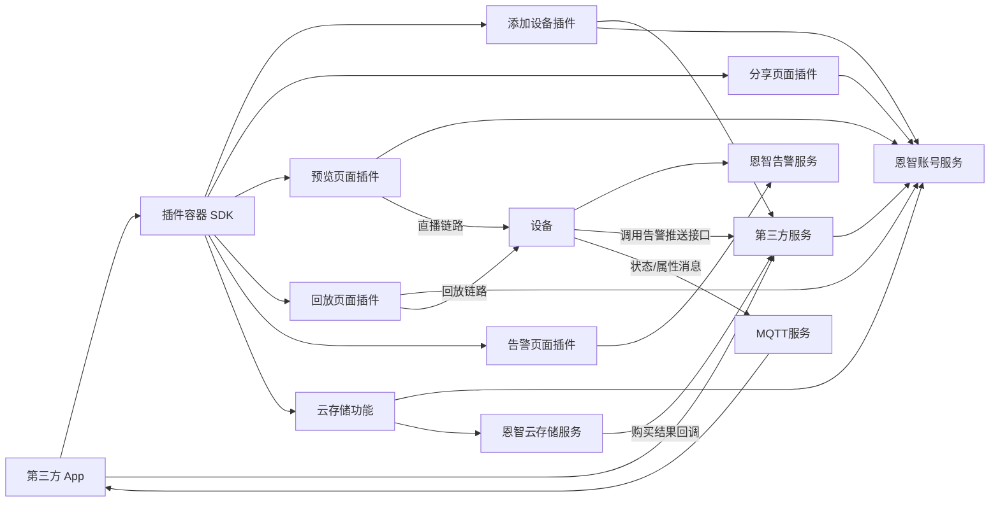

### 3.1 分层职责

| 层级 | 职责 |
| --- | --- |
| 第三方 App | 登录态维护、插件入口展示、插件初始化、页面跳转承载、MQTT 订阅与消息分发 |
| 第三方服务 | 维护第三方账号体系、调用恩智服务同步账号、绑定、分享设备添加、设备解绑等数据，处理幂等和重试 |
| 插件容器 SDK | 登录态注入、插件生命周期管理、统一日志、错误码透传、订阅结果消费 |
| 业务页面插件 | 按页面提供添加设备、分享、预览、回放、云存储、告警等完整 UI 和业务逻辑 |
| 恩智服务 | 维护恩智账号、设备关系、设备能力、云存储、告警数据、设备状态和属性变更消息 |
| MQTT服务 | 向 App 端推送设备运行状态和设备属性变更 |

## 4. 模块插件划分

| 模块/插件 | 主要能力 | 数据依赖 | UI 一致性要求 |
| --- | --- | --- | --- |
| 添加设备页面插件 | 扫码、解析设备信息、管理员绑定、分享二维码添加 | UserId、设备序列号（License）、绑定关系、分享关系 | 与恩智App添加设备流程一致 |
| 分享页面插件 | 分享列表、创建分享、删除分享、权限和时间配置 | 管理员关系、分享者 UserId、通道权限、分享时间 | 与恩智App分享页面一致 |
| 预览页面插件 | 直播预览、云台、对讲、截图、录像、清晰度切换等 | 设备权限、通道权限、设备状态、设备能力 | 与恩智App预览页一致 |
| 回放页面插件 | 日期选择、录像检索、时间轴、录像播放、下载等 | 设备权限、通道权限、录像索引 | 与恩智App回放页一致 |
| 云存储功能 | 云存储套餐购买入口、云存储回放 | UserId、设备序列号（License）、云存储套餐状态、云存储视频文件 | 与恩智App云存储购买和回放体验一致 |
| 告警页面插件 | 告警列表、筛选、告警图片查看、告警详情 | 设备权限、通道权限、告警数据 | 与恩智App告警页一致 |

## 5. 核心一致性原则

### 5.1 账号一致性

第三方账号注册、登录、注销仍由第三方账号服务负责。第三方账号创建成功后，第三方服务必须调用恩智账号服务完成用户 UserId 同步。

账号注销时，第三方服务应先完成本地账号注销或冻结，再调用恩智账号服务同步注销状态。若同步失败，第三方服务必须进入重试或补偿流程，避免两边账号状态长期不一致。

### 5.2 绑定关系一致性

管理员绑定设备时，第三方服务和恩智账号服务都必须保存同一份用户与设备绑定关系。绑定关系至少包含：

- UserId
- 设备序列号（License）
- 设备名称
- 设备通道信息
- 绑定角色：admin
- 绑定时间
- 绑定状态

建议第三方服务使用业务流水号 `requestId` 调用恩智接口，实现幂等处理。相同 `requestId` 重复提交时，恩智服务应返回同一业务结果。

### 5.3 分享关系一致性

设备分享必须保持以下字段一致：

- 管理员 UserId
- 分享者 UserId
- 设备序列号（License）
- 通道权限
- 功能权限
- 分享开始时间
- 分享结束时间
- 分享状态

创建分享、修改分享权限、删除分享由恩智账号服务维护。分享者扫码添加分享设备时，第三方服务保存第三方侧分享设备关系，并与恩智账号服务中的分享关系保持一致。删除分享后，恩智账号服务必须删除或置失效对应分享关系；预览、回放、云存储、告警插件必须基于最新分享关系做权限判断。

### 5.4 权限一致性

插件页面不直接信任本地缓存权限。进入预览、回放、云存储、告警等页面时，插件应通过恩智账号服务获取当前用户对设备的有效权限，再决定 UI 展示和业务操作范围。

## 6. 插件接入流程

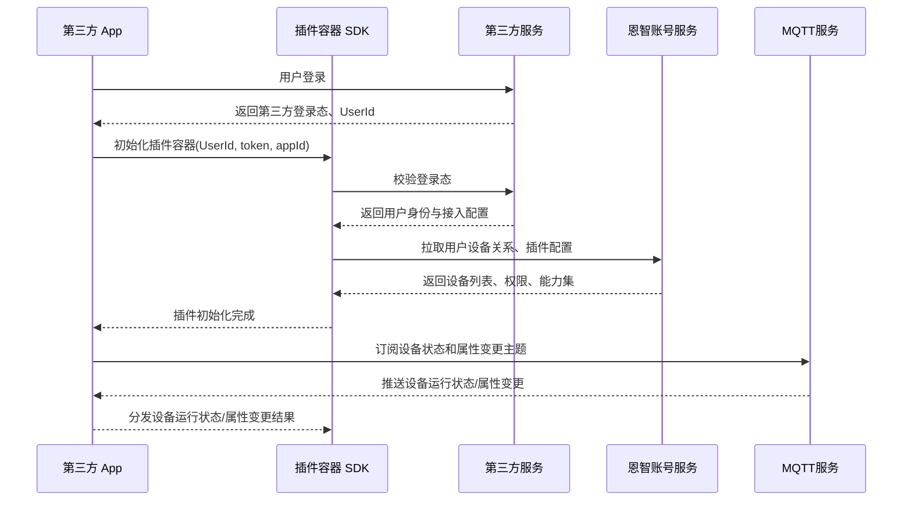

## 7. 账号业务流程

### 7.1 账号注册同步

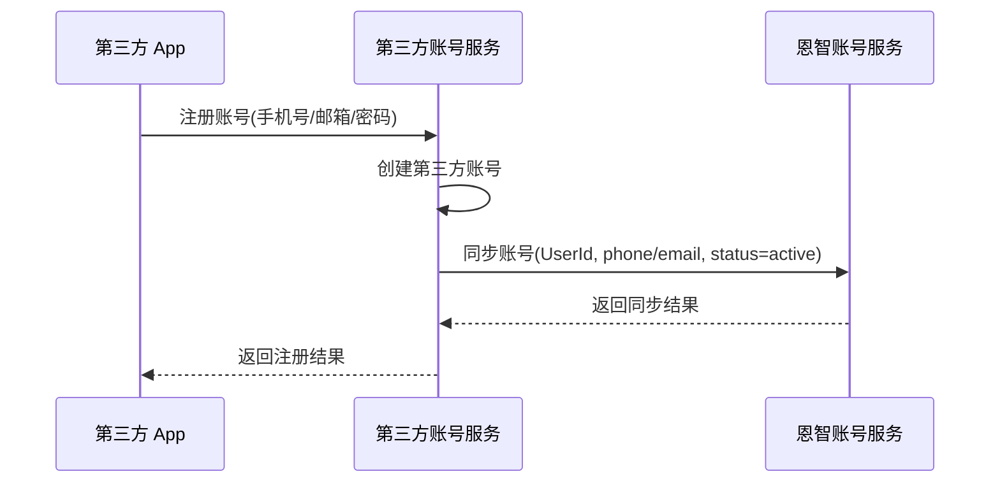

### 7.2 账号注销同步

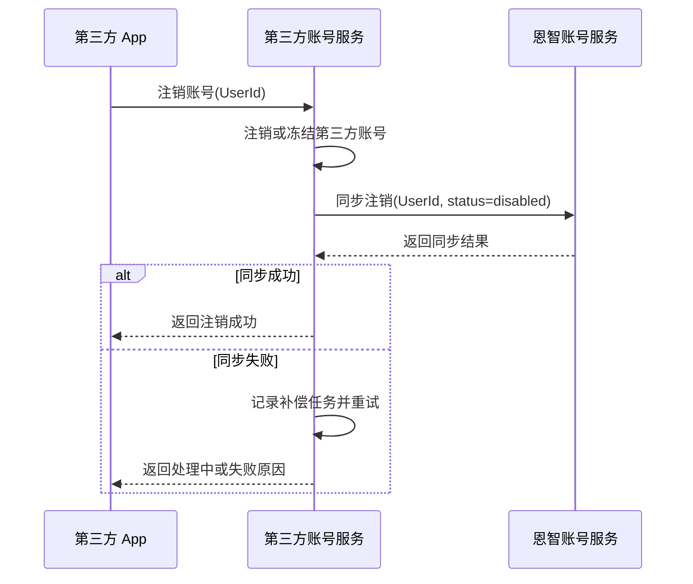

## 8. 添加设备页面插件

### 8.1 插件职责

添加设备页面插件负责复用恩智App现有添加设备 UI 和业务逻辑，支持管理员扫码绑定设备，也支持分享者扫码添加已分享设备。

插件负责：

- 调用相机或扫码能力识别设备二维码。
- 解析二维码中的设备序列号（License）、设备类型、通道信息、分享标识等。
- 根据二维码类型发起绑定或分享添加流程。
- 展示添加进度和添加结果。
- 透传第三方服务返回的错误码；第三方服务调用恩智服务失败时，应透传或映射恩智服务错误码，便于定位问题。

### 8.2 管理员绑定设备流程

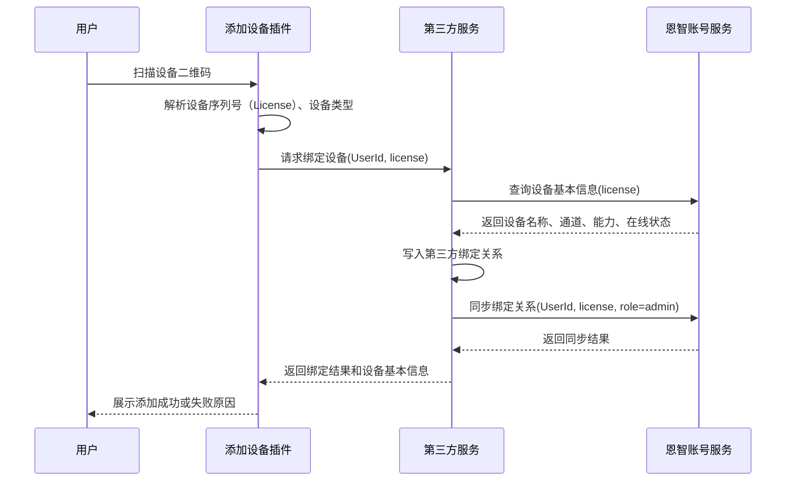

### 8.3 分享二维码添加流程

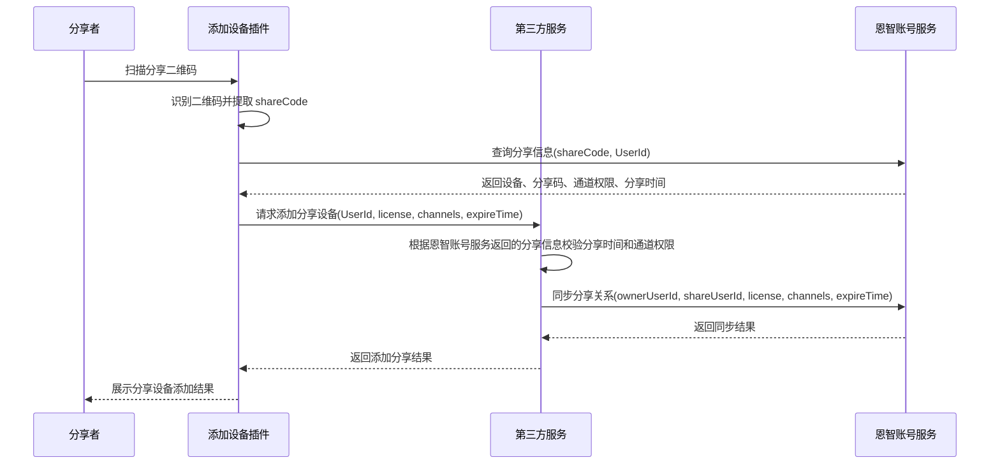

## 9. 分享页面插件

### 9.1 插件职责

分享页面插件负责复用恩智App分享页面 UI，提供分享列表、创建分享、修改权限、删除分享等能力。

插件必须保证：

- 只有管理员可创建、修改、删除分享。
- 分享者只能查看自己的分享关系，不允许扩大权限。
- 创建分享、修改权限、删除分享由恩智账号服务维护，分享页面插件不需要经过第三方服务。
- 删除分享后，预览、回放、云存储、告警插件立即失效对应权限。

### 9.2 创建分享流程

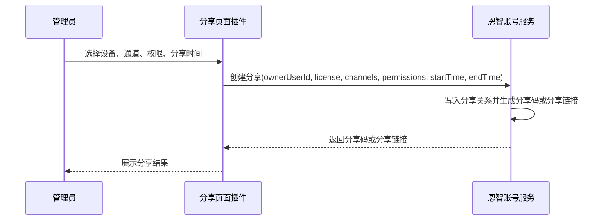

### 9.3 删除分享流程

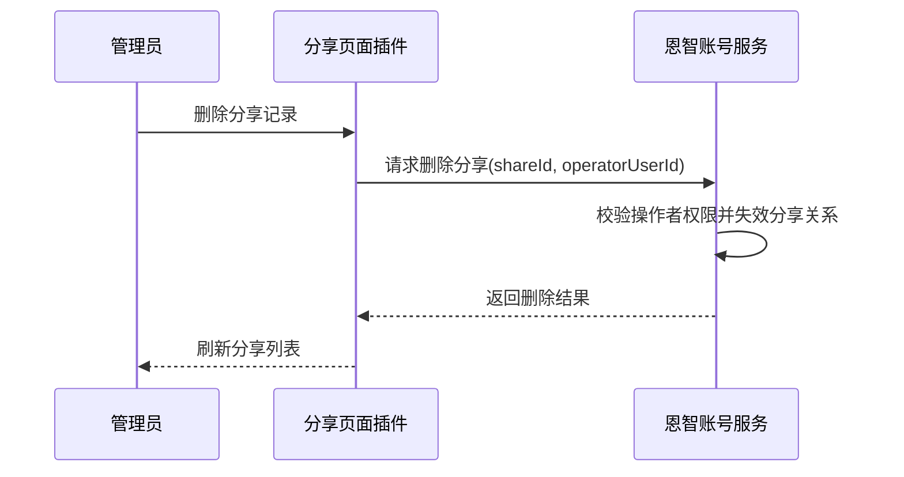

## 10. 设备解绑流程

设备解绑通常由管理员发起。解绑成功后，必须同步删除该设备所有分享关系。

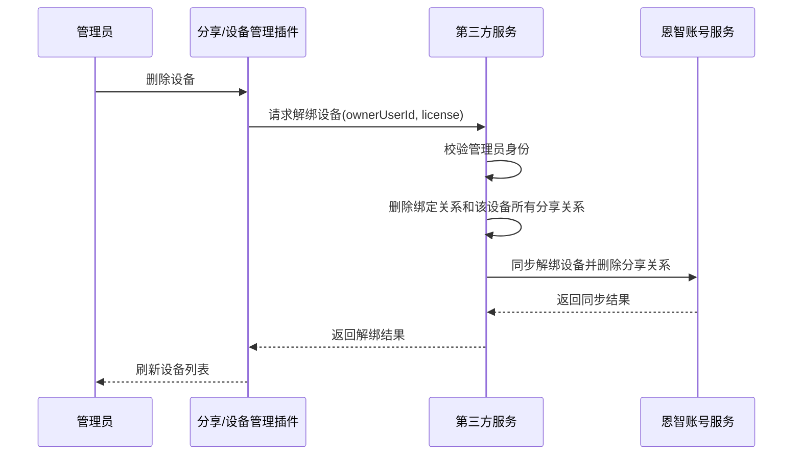

## 11. 预览页面插件

### 11.1 插件职责

预览页面插件复用恩智App现有直播 UI 和业务逻辑，提供直播播放、通道切换、清晰度切换、云台、语音对讲、截图、录像、设备控制等功能。

进入页面前必须先校验：

- 当前用户是否拥有该设备访问权限。
- 当前用户是否在分享有效期内。
- 当前用户是否拥有对应通道权限。
- 当前设备是否在线，是否支持目标功能。

### 11.2 预览流程

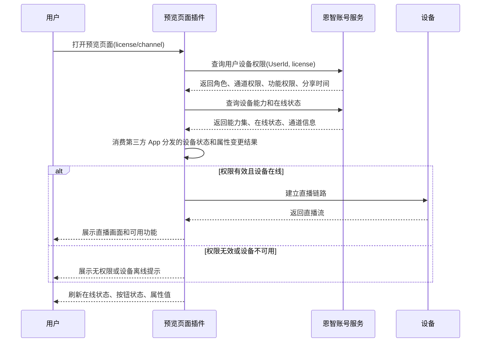

## 12. 回放页面插件

### 12.1 插件职责

回放页面插件复用恩智App现有录像回放 UI 和业务逻辑，提供录像日期选择、录像检索、时间轴展示、录像播放、录像下载等能力。

回放能力必须受分享权限控制。分享者只能查看被授权通道、被授权时间范围内的录像。

### 12.2 回放流程

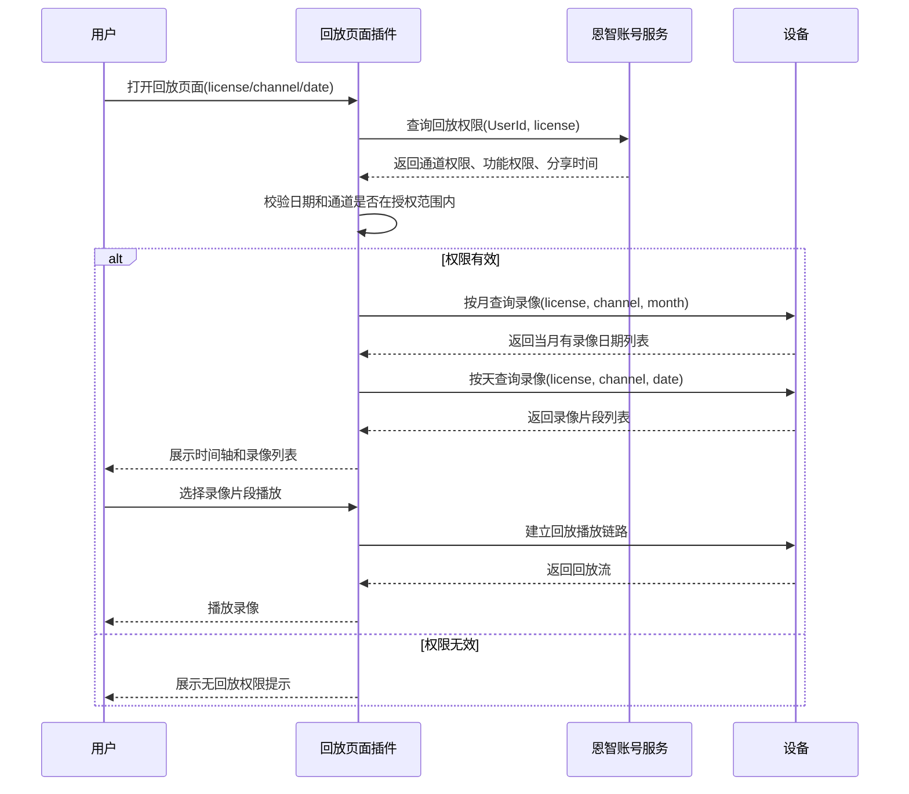

## 13. 云存储功能

### 13.1 功能说明

云存储功能按业务功能分为：

- 云存储套餐购买入口：第三方 App 或插件页面进入云存储套餐购买时，由恩智服务提供 H5 地址。
- 云存储套餐购买结果同步：用户在云存储 H5 页面完成套餐购买后，恩智云存储服务需要调用第三方服务平台 API 接口，将云存储套餐购买 `requestId` 等信息发送给第三方服务平台。
- 云存储回放界面：云存储回放界面与回放功能保持一致，用户可以在云存储回放界面查看云存储中的视频文件。

### 13.2 云存储购买流程

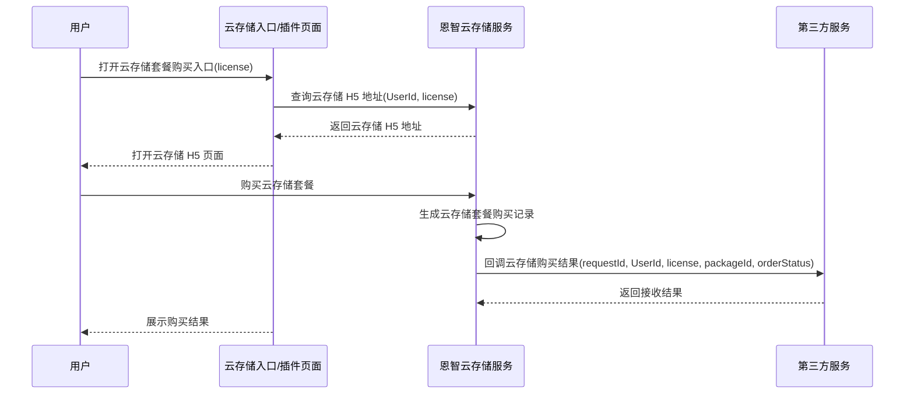

### 13.3 云存储回放流程

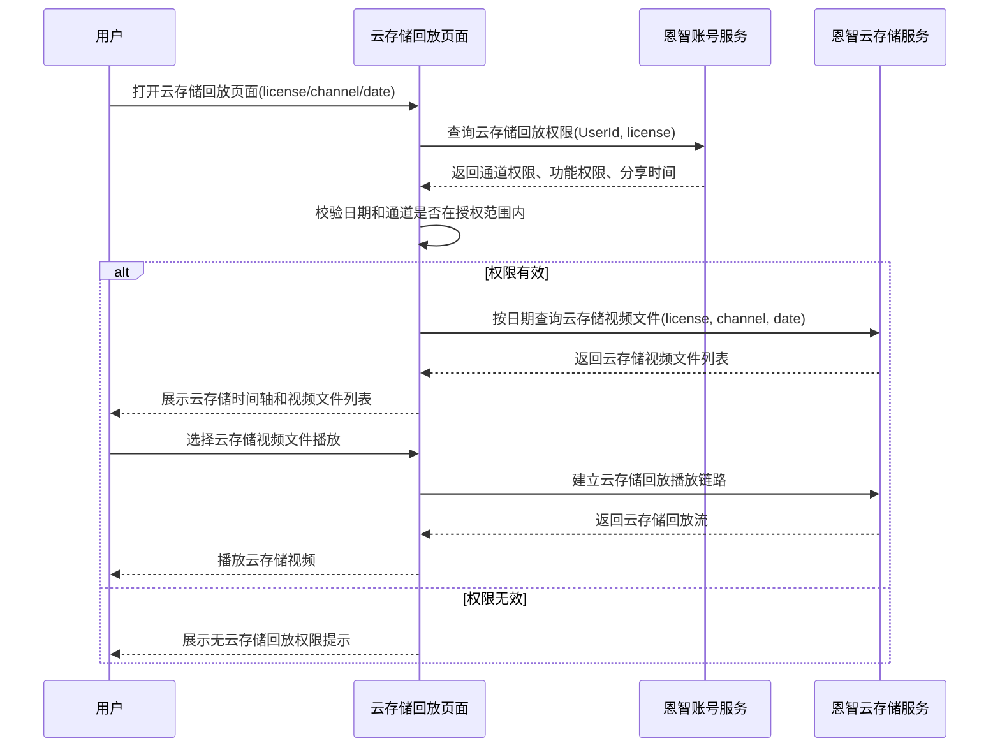

## 14. 告警页面插件

### 14.1 插件职责

告警页面插件复用恩智App告警页面 UI 和业务逻辑，提供告警列表、告警筛选、告警详情、告警图片查看等能力。

告警页面插件与第三方服务没有关联，告警列表和告警详情仍按恩智App原有业务逻辑从恩智告警服务获取。第三方服务与恩智告警服务没有必然的直接调用关系；设备产生告警后，需要调用第三方服务提供的告警推送接口，使第三方服务平台中生成对应告警消息，同时设备也会按原有业务链路向恩智告警服务上报告警。只要设备联网正常，且第三方服务和恩智服务运行稳定，两边告警数据可以保持一致。

### 14.2 告警查看流程

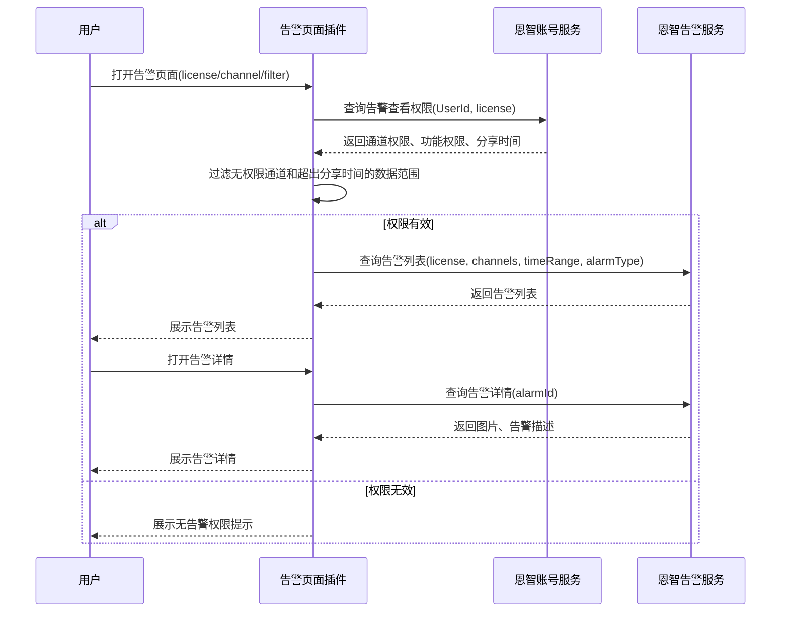

### 14.3 设备告警推送到第三方服务

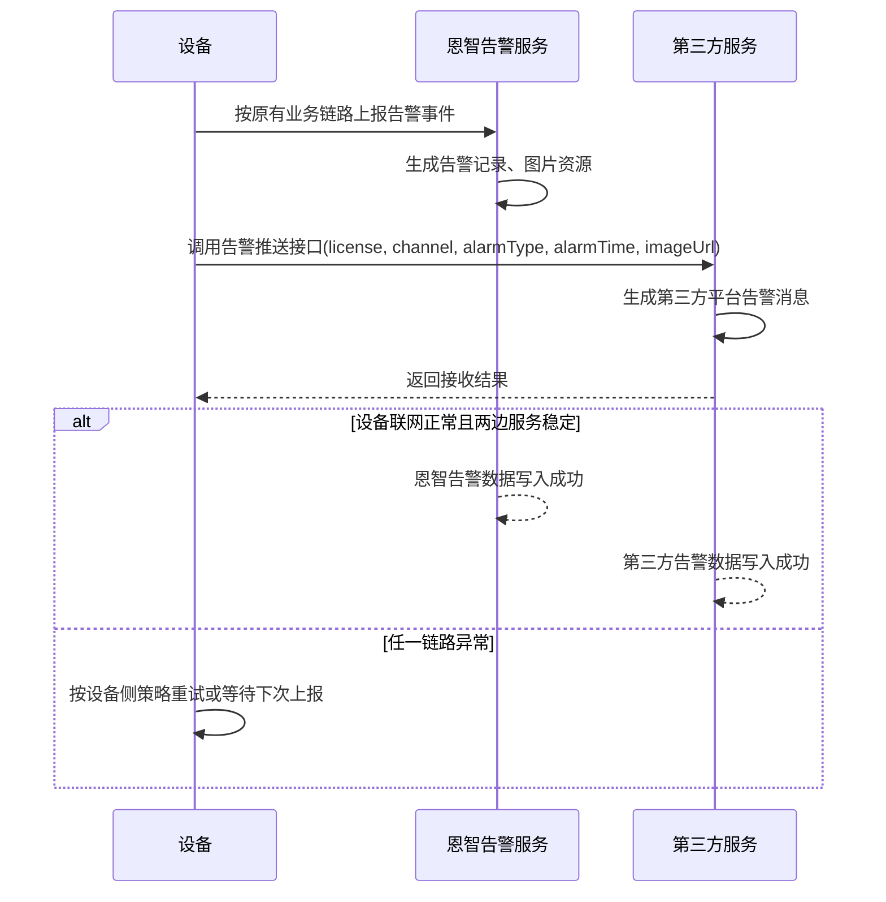

## 15. 设备基本信息查询接口

### 15.1 接口用途

设备基本信息查询接口用于第三方服务在绑定、预览、回放、云存储、告警等场景下获取设备基础属性信息，便于展示 UI 和识别设备能力。接口响应中的 `data` 数据内容与 `16.4 设备属性变更通知` 的消息内容一致。

### 15.2 请求方向

第三方服务调用恩智账号服务。

```text
GET /openapi/v1/devices/basic-info
```

### 15.3 请求参数

| 字段 | 类型 | 必填 | 说明 |
| --- | --- | --- | --- |
| appId | string | 是 | 第三方应用标识 |
| UserId | string | 是 | 当前用户 ID |
| license | string | 是 | 设备序列号（License） |
| requestId | string | 是 | 请求流水号，用于日志追踪和幂等 |
| timestamp | int64 | 是 | 请求时间戳 |
| sign | string | 是 | 请求签名 |

### 15.4 响应字段

| 字段 | 类型 | 说明 |
| --- | --- | --- |
| code | int | 业务错误码 |
| message | string | 错误描述 |
| requestId | string | 请求流水号 |
| data.sn | string | 设备 sn |
| data.type | int | 设备类型，参考 `16.4 设备属性变更通知` 中的 `devType` 宏定义 |
| data.model | string | 设备型号 |
| data.region | string | IoT 注册站点 |
| data.chNum | int | 设备通道数 |
| data.vendor | string | 设备定制厂商 Id |
| data.firmwareVersion | string | 固件版本 |
| data.firmwareDate | int | 固件编译日期 |
| data.p2pVersion | string | p2p 版本 |
| data.netInfo | object | 网络信息对象，字段参考 `16.4 设备属性变更通知` |
| data.otherInfo | object | 其他信息对象，字段参考 `16.4 设备属性变更通知` |

### 15.5 响应示例

```json
{
  "code": 0,
  "message": "success",
  "requestId": "202608230001",
  "data": {
    "sn": "03cd0002007bfc0bc3ff",
    "type": 18,
    "model": "",
    "region": "cn-north-1",
    "vendor": "HDT-NEUTRAL",
    "chNum": 8,
    "firmwareVersion": "V2.3.0",
    "firmwareDate": 20241120,
    "p2pVersion": "V1.0.39.2025051618",
    "netInfo": {
      "ethInfo": {
        "gateway": "10.0.0.1",
        "ip": "10.0.0.207",
        "netMask": "255.0.0.0"
      },
      "type": 0
    },
    "otherInfo": {
      "disk": 1,
      "status": 1,
      "pushLive": 1,
      "pushPlayback": 1,
      "oneArming": 1
    },
    "iotPlatformId": 1,
    "ipAddress": ""
  }
}
```

## 16. MQTT 订阅说明

App 设备列表中的设备运行状态和设备属性变更通过订阅 MQTT 主题实现。第三方 App 负责 MQTT 连接、鉴权、订阅、重连和消息分发；插件容器 SDK 与各业务插件只消费第三方 App 分发后的设备状态和属性变化结果，并刷新对应 UI。

### 16.1 订阅时机

- 第三方 App 在用户登录成功并获取 UserId 后，订阅当前用户设备列表的状态主题和属性变更主题。
- 第三方 App 可根据登录态和 App 生命周期保留或释放 MQTT 订阅。
- 用户退出登录时，第三方 App 必须断开 MQTT 并清理本地订阅缓存。

### 16.2 建议主题

| 主题 | 说明 |
| --- | --- |
| `device/${userId}/+/state` | 设备运行状态通知，用于接收设备在线/离线消息 |
| `${userId}/devicePropertyChange` | 设备属性变更通知，用于实时接收设备属性变更消息 |

### 16.3 设备运行状态通知

简要描述：

- 即时接收设备在线/离线消息

消息主题：

```text
device/${userId}/+/state
```

参数定义：

| 参数名 | 必选 | 类型 | 说明 |
| --- | --- | --- | --- |
| serialNo | 是 | string | 设备序列号 |
| status | 是 | int | 设备运行状态，`1-在线`，`2-离线` |
| time | 是 | int | 时间戳，单位为秒 |

消息内容示例：

```json
{
  "serialNo": "03ed00200585591e199",
  "status": 1,
  "time": 1722393882
}
```

### 16.4 设备属性变更通知

消息主题：

```text
${userId}/devicePropertyChange
```

参数定义：

| 参数名 | 必选 | 类型 | 说明 |
| --- | --- | --- | --- |
| sn | 是 | string | 设备 sn |
| type | 是 | int | 设备类型，参考 `devType` 宏定义 |
| model | 是 | string | 设备型号 |
| region | 是 | string | IoT 注册站点，参考 `region` 宏定义 |
| chNum | 是 | int | 设备通道数 |
| vendor | 是 | string | 设备定制厂商 Id，参考设备定制厂商标识定义 |
| firmwareVersion | 是 | string | 固件版本 |
| firmwareDate | 是 | int | 固件编译日期 |
| p2pVersion | 是 | string | p2p 版本 |
| netInfo | 是 | object | 网络信息对象，参考 `netInfo` 参数定义 |
| otherInfo | 是 | object | 其他信息对象，参考 `otherInfo` 参数定义 |

devType 宏定义：

| 宏定义值 | 对应于 App 端展示信息 | 说明 |
| --- | --- | --- |
| 12 | Wired IPCAM | 有线-单目摄像机 |
| 13 | WiFi IPCAM | WiFi-单目摄像机 |
| 14 | 4G IPCAM | 4G-单目摄像机 |
| 15 | Wired Binocular IPCAM | 有线-双目摄像机 |
| 16 | WiFi Binocular IPCAM | WiFi-双目摄像机 |
| 17 | 4G Binocular IPCAM | 4G-双目摄像机 |
| 18 | Wired PoE NVR | 有线-PoE-NVR |
| 19 | WiFi PoE NVR | WiFi-PoE-NVR |
| 20 | 4G PoE NVR | 4G-PoE-NVR |
| 21 | Wired NVR | 普通有线-NVR |
| 22 | Wifi NVR | 普通Wifi-NVR |
| 23 | 4g NVR | 普通4G-NVR |

region 宏定义：

| 宏定义值 | 说明 |
| --- | --- |
| us-east-1 | 美国站点 |
| ap-southeast-1 | 新加坡站点 |
| eu-central-1 | 法兰克福站点 |

netInfo 参数定义：

| 参数名 | 必选 | 类型 | 说明 |
| --- | --- | --- | --- |
| type | 是 | int | 网络类型，`0-有线`，`1-WiFi`，`2-4G`，`3-未知` |
| ethInfo | 否 | object | 有线网络信息，参考 `ethInfo` 参数定义 |
| wifiInfo | 否 | object | 无线网络信息，参考 `wifiInfo` 参数定义 |
| 4gInfo | 否 | object | 4G 网络信息，参考 `4gInfo` 参数定义 |

ethInfo 参数定义：

| 参数名 | 必选 | 类型 | 说明 |
| --- | --- | --- | --- |
| ip | 是 | string | 本机地址 |
| netMask | 是 | string | 子网掩码 |
| gateway | 是 | string | 网关地址 |

wifiInfo 参数定义：

| 参数名 | 必选 | 类型 | 说明 |
| --- | --- | --- | --- |
| ssid | 是 | string | WiFi 网络名称 |
| ip | 是 | string | 本机地址 |
| netMask | 是 | string | 子网掩码 |
| gateway | 是 | string | 网关地址 |

4gInfo 参数定义：

| 参数名 | 必选 | 类型 | 说明 |
| --- | --- | --- | --- |
| isp | 是 | string | 网络运营商名称 |
| signalStrength | 是 | int | 网络信号等级，取值范围 `0-100` |
| ccid | 是 | string | 流量卡号信息 |
| imei | 是 | string | imei 信息 |
| status | 是 | int | 状态，`0-网络异常`，`1-网络正常`，`2-无服务` |
| factoryName | 是 | string | 定制流量卡厂商名称 |
| factoryId | 是 | string | 定制流量卡标识 |
| ip | 是 | string | 本机地址 |

otherInfo 参数定义：

| 参数名 | 必选 | 类型 | 说明 |
| --- | --- | --- | --- |
| disk | 是 | int | 设备是否接入磁盘，`0-未接入`，`1-已接入` |
| status | 是 | int | 磁盘状态，参考磁盘状态宏定义 |
| pushLive | 是 | int | 是否支持推送实时流，`0-不支持`，`1-支持` |
| pushPlayback | 是 | int | 是否支持推送回放流，`0-不支持`，`1-支持` |
| oneArming | 是 | int | 一键布防撤防状态，`0-撤防`，`1-布防` |

磁盘状态宏定义：

| 参数值 | 说明 |
| --- | --- |
| -3 | 磁盘异常 |
| -2 | 磁盘需要格式化 |
| -1 | 未发现磁盘 |
| 0 | 正常 |
| 1 | 正在录像 |

有线-设备基本属性示例：

```json
{
  "sn": "03cd0002007bfc0bc3ff",
  "type": 18,
  "model": "",
  "region": "cn-north-1",
  "vendor": "HDT-NEUTRAL",
  "chNum": 8,
  "firmwareVersion": "V2.3.0",
  "firmwareDate": 20241120,
  "p2pVersion": "V1.0.39.2025051618",
  "netInfo": {
    "ethInfo": {
      "gateway": "10.0.0.1",
      "ip": "10.0.0.207",
      "netMask": "255.0.0.0"
    },
    "type": 0
  },
  "otherInfo": {
    "disk": 1,
    "status": 1,
    "pushLive": 1,
    "pushPlayback": 1,
    "oneArming": 1
  },
  "iotPlatformId": 1,
  "ipAddress": ""
}
```

无线-设备基本属性示例：

```json
{
  "sn": "03cd0002007bfc0bc3ff",
  "type": 18,
  "model": "",
  "region": "cn-north-1",
  "vendor": "HDT-NEUTRAL",
  "chNum": 8,
  "firmwareVersion": "V2.3.0",
  "firmwareDate": 20241120,
  "p2pVersion": "V1.0.39.2025051618",
  "netInfo": {
    "type": 1,
    "wifiInfo": {
      "ssid": "xxxxxx",
      "ip": "192.168.1.200",
      "netMask": "255.255.255.0",
      "gateway": "192.168.1.1"
    }
  },
  "otherInfo": {
    "disk": 1,
    "status": 1,
    "pushLive": 1,
    "pushPlayback": 1,
    "oneArming": 1
  },
  "iotPlatformId": 1,
  "ipAddress": ""
}
```

4G-设备基本属性示例：

```json
{
  "sn": "03cd0002007bfc0bc3ff",
  "type": 18,
  "model": "",
  "region": "cn-north-1",
  "vendor": "HDT-NEUTRAL",
  "chNum": 8,
  "firmwareVersion": "V2.3.0",
  "firmwareDate": 20241120,
  "p2pVersion": "V1.0.39.2025051618",
  "netInfo": {
    "type": 2,
    "4gInfo": {
      "isp": "xxxxxx",
      "signalStrength": 90,
      "ccid": "xxxxx",
      "status": 1,
      "factoryName": "xxxx",
      "factoryId": "xxxx",
      "ip": "192.168.1.200"
    }
  },
  "otherInfo": {
    "disk": 1,
    "status": 1,
    "pushLive": 1,
    "pushPlayback": 1,
    "oneArming": 1
  },
  "iotPlatformId": 1,
  "ipAddress": ""
}
```

### 16.5 插件处理要求

- 预览页面收到离线事件后，应停止直播链路或展示设备离线状态。
- 回放页面收到存储异常事件后，应提示录像数据可能不可用。
- 告警页面应按权限查询恩智告警服务，并根据查询结果刷新告警列表。
- 分享权限变更或删除后，插件容器应重新拉取权限并通知页面刷新。
- MQTT 消息只作为状态刷新和事件通知，不替代服务端权限校验。

## 17. 接口与数据一致性要求

### 17.1 必须支持的接口

| 接口 | 调用方 | 接收方 | 用途 |
| --- | --- | --- | --- |
| 账号同步接口 | 第三方服务 | 恩智账号服务 | 注册、注销、状态同步 |
| 设备绑定接口 | 第三方服务 | 恩智账号服务 | 同步管理员与设备绑定关系 |
| 设备解绑接口 | 第三方服务 | 恩智账号服务 | 删除绑定关系和分享关系 |
| 创建分享接口 | 分享页面插件 | 恩智账号服务 | 创建分享关系并生成分享码或分享链接 |
| 删除分享接口 | 分享页面插件 | 恩智账号服务 | 删除或失效分享关系 |
| 分享设备添加同步接口 | 第三方服务 | 恩智账号服务 | 分享者扫码添加分享设备后，同步分享者、通道权限、分享时间 |
| 设备基本信息查询接口 | 第三方服务 | 恩智账号服务 | 查询设备基础属性信息 |
| 云存储 H5 地址查询接口 | 云存储入口/插件页面 | 恩智云存储服务 | 查询云存储套餐购买 H5 地址 |
| 云存储购买结果回调接口 | 恩智云存储服务 | 第三方服务 | 云存储套餐购买成功后，同步 `requestId` 等购买结果 |
| 告警查询接口 | 插件容器/告警插件 | 恩智告警服务 | 查询告警列表和详情 |
| 设备告警推送接口 | 设备 | 第三方服务 | 设备向第三方服务推送告警事件 |

### 17.2 幂等与补偿

所有写接口必须携带 `requestId`。发起方应记录每次调用恩智服务的请求流水、请求参数、响应结果和最终状态；由第三方服务发起的同步接口，第三方服务必须记录完整补偿状态。

建议写接口状态如下：

| 状态 | 说明 |
| --- | --- |
| pending | 本地业务已受理，等待同步恩智服务 |
| synced | 已同步成功 |
| failed | 同步失败，可重试 |
| compensating | 正在补偿处理 |
| closed | 已完成或已人工确认 |

### 17.3 对账机制

建议双方至少支持以下对账能力：

- 按 UserId 查询账号状态。
- 按设备序列号（License）查询绑定关系。
- 按设备序列号（License）查询分享者列表、通道权限和分享时间。
- 按分享者 UserId 查询被分享设备列表。
- 按设备序列号（License）、通道和时间范围查询告警数据同步状态。
- 按 UserId 和设备序列号（License）查询云存储套餐状态、购买 `requestId` 和套餐有效期。
- 支持按时间范围导出异常同步记录。

## 18. 日志与问题定位

插件化接入的一个核心目标是清晰定位问题。建议所有链路统一携带以下字段：

| 字段 | 说明 |
| --- | --- |
| requestId | 单次业务请求流水 |
| traceId | 跨服务链路追踪 ID |
| appId | 第三方应用标识 |
| UserId | 当前用户 ID |
| license | 当前设备序列号（License） |
| pluginName | 插件名称 |
| pageName | 页面名称 |
| apiName | 调用接口名称 |
| errorCode | 错误码 |
| errorMessage | 错误描述 |

### 18.1 定位原则

- 插件 UI 显示异常：优先检查插件版本、页面入参、用户权限、设备能力集。
- 绑定失败：检查二维码解析、第三方绑定结果、恩智绑定同步结果。
- 分享权限异常：检查分享关系、通道权限、分享时间、删除状态。
- 预览/回放失败：检查权限、设备在线状态、设备能力、媒体链路。
- 云存储购买结果缺失：检查云存储购买记录、恩智云存储服务回调第三方服务记录、第三方服务接收日志。
- 云存储回放失败：检查云存储套餐状态、云存储回放权限、云存储视频文件索引和播放链路。
- 告警缺失：检查设备上报链路、第三方告警推送接口、告警服务数据、用户通道权限、分享时间范围。
- 设备状态不刷新：检查 MQTT 连接、订阅主题、消息分发、页面事件监听。

## 19. 第三方接入步骤

1. 第三方申请 `appId`、`appSecret`、接口权限和 MQTT 接入配置。
2. 第三方服务接入账号同步、设备绑定、设备解绑、分享设备添加同步、云存储购买结果回调接口。
3. 第三方 App 集成插件容器 SDK。
4. 第三方 App 初始化插件容器，注入 UserId、登录 token、appId。
5. 按业务入口打开添加设备、分享、预览、回放、云存储、告警插件页面。
6. 第三方 App 订阅 MQTT 状态和属性主题，并向插件容器分发订阅结果。
7. 双方联调账号、绑定、分享、预览、回放、云存储、告警完整链路。
8. 上线前完成数据对账、异常补偿、日志追踪和错误码验收。

## 20. 验收标准

| 模块 | 验收标准 |
| --- | --- |
| 账号 | 第三方账号注册、注销后，恩智账号服务状态一致 |
| 绑定 | 管理员绑定设备后，两边用户设备关系一致 |
| 分享 | 恩智账号服务中的分享关系准确，分享者扫码添加后第三方侧分享设备关系与其保持一致 |
| 添加设备插件 | UI 和恩智App一致，绑定/分享添加流程完整 |
| 分享页面插件 | UI 和恩智App一致，支持创建、查看、删除分享 |
| 预览页面插件 | UI 和恩智App一致，按权限展示可用功能 |
| 回放页面插件 | UI 和恩智App一致，按权限查询和播放录像 |
| 云存储 | 可打开恩智服务提供的云存储 H5 地址，购买成功后第三方服务可收到 `requestId` 等购买结果，云存储回放可查看云存储视频文件 |
| 告警页面插件 | UI 和恩智App一致，按权限查看告警列表和详情 |
| 设备基本信息接口 | 可按设备序列号（License）查询设备基础属性信息，响应数据与设备属性变更消息一致 |
| MQTT | 设备运行状态和属性变更可实时刷新到对应插件页面 |
| 问题定位 | 每条业务链路均可通过 requestId/traceId 查到调用记录 |

## 21. 后续待确认事项

- 设备二维码字段格式和分享二维码字段格式。
- 第三方服务与恩智服务的签名算法、token 有效期和错误码规范。
- 设备基本信息接口最终 URL、字段命名和权限返回策略。
- 云存储 H5 地址获取参数、购买结果回调字段、回调重试策略。
- MQTT 主题命名、QoS、保活、断线重连和离线消息策略。
- 恩智App在不同产品线上的 UI 差异是否需要按品牌独立配置。
- 分享权限粒度是否只到通道，还是需要细分到预览、回放、告警、云台、对讲、配置等功能级权限。

## 22. 第三方服务平台与恩智服务平台对接过程中的风险意识

第三方服务平台与恩智服务平台对接时，应提前关注数据同步、权限判断和异常补偿问题。以下数据可能因网络、服务异常或回调延迟出现短时不一致，需要通过日志、重试、对账和补偿机制处理。

- 账号服务数据一致性：账号注册、注销、冻结、恢复等状态，需要在第三方服务平台和恩智账号服务中保持一致。
- 账号与设备关系一致性：设备绑定、解绑、分享关系变更后，需要保证用户、设备、角色、操作权限、通道权限和分享时间段一致。
- 告警数据一致性：设备向恩智告警服务和第三方服务平台上报告警时，两边的告警记录、告警图片、告警时间、设备序列号（License）和通道信息可能短时不一致，需要支持后续对账和补偿。
- 云存储套餐数据一致性：用户购买、续费、变更或取消云存储套餐后，两边的套餐状态、购买 `requestId`、设备序列号（License）和套餐有效期可能短时不一致，需要支持回调重试、对账和补偿。
